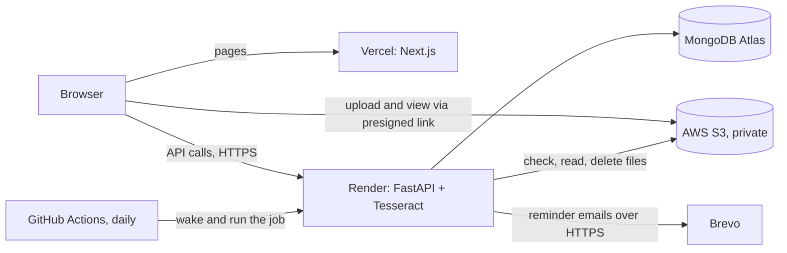
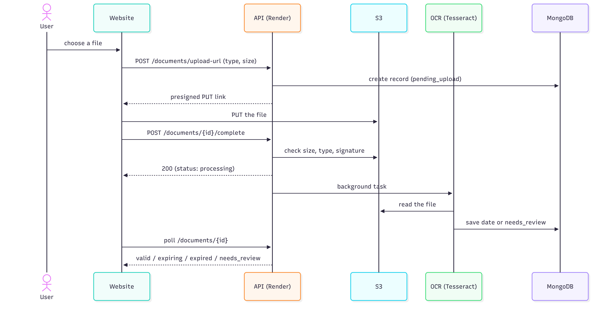

# DocDue

**Know before it expires.** DocDue keeps licences, certificates, insurance policies and permits in one place. It reads the expiry date from the scan with OCR and emails you before it runs out.

Live site: https://doc-due.vercel.app

Author: Dinu Devees George

## What it does

- Accounts for one person or for an organization (a "tenant"). Admins manage the team. Members work with documents.
- Upload a PDF, JPEG or PNG. The file goes from the browser straight to a private, encrypted AWS S3 bucket through a short-lived presigned link.
- Tesseract OCR reads the document and the app picks the expiry date. If it is not confident it asks a person instead of guessing ("needs review").
- Documents are shown as Valid, Expiring soon, Expired or Needs review, with colour and a status stamp.
- A daily job updates statuses, removes unfinished uploads and emails reminders (30, 14, 7, 1 and 0 days before expiry), each only once.
- Login with JWT access and refresh tokens. Passwords are stored as bcrypt hashes.

## Architecture



## Tech stack

| Layer | Technology |
|---|---|
| Frontend | Next.js (App Router), React, TypeScript, Tailwind CSS 4 |
| Backend | FastAPI (Python), Pydantic, Beanie (MongoDB ODM) |
| Database | MongoDB Atlas (free M0) |
| File storage | AWS S3 with a least-privilege IAM user |
| OCR | Tesseract through pytesseract, PyMuPDF for PDFs |
| Email | Brevo API (production), SMTP or console (development) |
| Scheduling | GitHub Actions calls a secured endpoint; APScheduler for always-on hosts |
| Hosting | Vercel (frontend), Render in a Docker image (backend). All on free plans |
| Tests | pytest, vitest |

## Run it on your computer

Needs Python 3.12 or newer, Node.js 20 or newer, Tesseract OCR, a MongoDB Atlas cluster and an S3 bucket.

```bash
# backend
cd backend
python -m venv .venv
.venv\Scripts\activate            # on macOS/Linux: source .venv/bin/activate
pip install -r requirements.txt
copy .env.example .env            # then fill in the values
uvicorn main:app --reload         # http://localhost:8000/docs

# frontend (a second terminal)
cd frontend
npm install
copy .env.example .env.local      # NEXT_PUBLIC_API_URL=http://localhost:8000/api/v1
npm run dev                       # http://localhost:3000
```

## Tests

```bash
cd backend  && pytest -q
cd frontend && npm run test && npm run build
```

## Environment variables

Names only. Real values go in `backend/.env` and in the hosting dashboards, never in Git.

| Where | Variables |
|---|---|
| Backend | `MONGODB_URI`, `MONGODB_DB_NAME`, `SECRET_KEY`, `AWS_ACCESS_KEY_ID`, `AWS_SECRET_ACCESS_KEY`, `AWS_REGION`, `S3_BUCKET_NAME`, `EMAIL_MODE`, `EMAIL_FROM`, `BREVO_API_KEY`, `CRON_SECRET`, `SCHEDULER_ENABLED`, `FRONTEND_URL`, `ENVIRONMENT` |
| Frontend | `NEXT_PUBLIC_API_URL`, `NEXT_PUBLIC_MAX_UPLOAD_MB` |

## Security notes

- Every query is filtered by tenant. Another tenant's document answers 404.
- The S3 bucket is private and TLS-only. Files are reached only through links that expire in minutes.
- Uploaded files are checked by size, type and real file signature.
- Raw OCR text is never stored or logged. Only the extracted date is kept.
- Production refuses to start with a weak `SECRET_KEY`. The API documentation pages are off in production.

## Known limitations

Free hosting sleeps after 15 minutes without visitors (first request about a minute). The database accepts connections from any address because the free host has no fixed IP. Emails come from one verified address and can land in Spam. Reminder days are the same for everyone. Linking one document into several vaults was designed, not built.

## Project process

Six sprints on a GitHub Project board, one branch per feature, merged into `main` and tagged: auth and database, S3 upload, OCR, scheduler and alerts, frontend, deployment.


### OCR Pipeline

